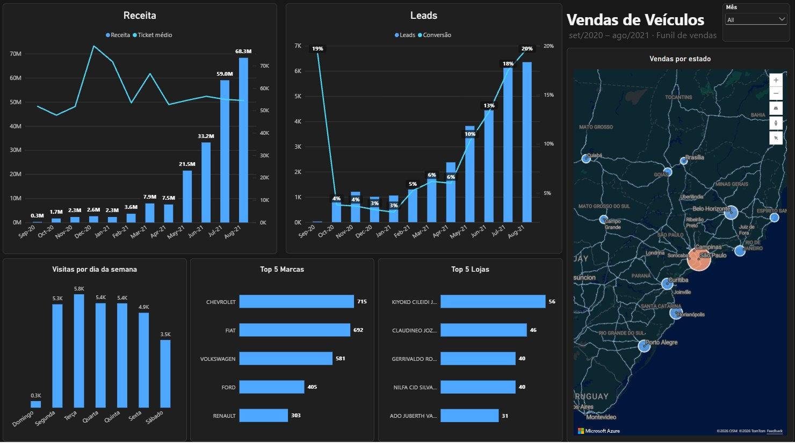
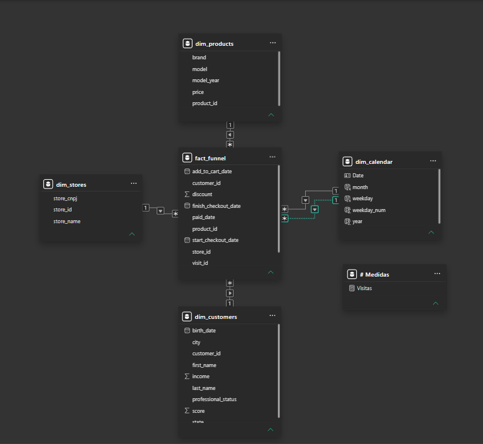

# Vendas de Veículos v2 · Modelo Estrela no Power BI

Remodelagem do projeto [Dashboard de Vendas de Veículos](https://github.com/DeivithMB/vehicle-sales-dashboard) em **esquema estrela**: uma tabela fato, quatro dimensões e uma tabela só de medidas DAX. Agora **um clique em qualquer visual filtra todo o painel**, e um único filtro de mês responde todas as perguntas.

**[▶ Abrir o dashboard ao vivo](https://app.powerbi.com/view?r=eyJrIjoiOWU2MGNkMTEtNjQzNS00Yzc3LTg2NDYtZTMzMzVjYjdlOTBhIiwidCI6ImFmZjY0MmI3LTg1MTEtNGFhMi04ZGIyLThkMDE3MTI0Yjc5NyJ9)** · **[Portfólio](https://deivithmb.github.io)**



---

## Por que uma versão 2?
Na versão 1, cada gráfico vinha de uma **view SQL já agregada** e independente. O painel funcionava, mas os visuais não conversavam entre si: clicar em um estado não filtrava as marcas, e os rankings ficavam presos em um único mês.

Na versão 2, os dados entram **no nível da visita** (uma linha por visita) e todo o cálculo passa a ser feito por **medidas DAX** sobre um modelo relacional.

| | v1 | v2 |
|---|---|---|
| Fonte | 5 views agregadas | tabela fato + 4 dimensões |
| Cálculos | no SQL | medidas DAX |
| Interação entre visuais | não | sim (cross-filtering) |
| Rankings e mapa | fixos em ago/2021 | qualquer mês, pelo filtro |

## O modelo


| Tabela | Papel |
|---|---|
| `fact_funnel` | fato: uma linha por visita ao site, com as datas do funil (visita → carrinho → checkout → pagamento) |
| `dim_customers` | clientes (dados pessoais como CPF, e-mail e celular removidos no Power Query) |
| `dim_products` | produtos: marca, modelo, ano e preço |
| `dim_stores` | lojas |
| `dim_calendar` | calendário criado em DAX, marcado como tabela de datas |
| `# Medidas` | tabela só com medidas |

**Duas datas, um calendário.** A fato tem duas datas importantes: a da **visita** e a do **pagamento**. O calendário se liga às duas:
- `visit_page_date` → relação **ativa** (usada por Visitas e Leads);
- `paid_date` → relação **inativa**, ligada só dentro das medidas de vendas com `USERELATIONSHIP`.

Assim, "visitas de agosto" e "vendas pagas em agosto" saem do mesmo filtro de mês, cada uma pela sua data.

## Medidas DAX
```DAX
Visitas = COUNTROWS(fact_funnel)

Leads = [Visitas]

Vendas =
CALCULATE(
    COUNT(fact_funnel[paid_date]),
    USERELATIONSHIP(dim_calendar[Date], fact_funnel[paid_date])
)

Receita =
CALCULATE(
    SUMX(fact_funnel, RELATED(dim_products[price]) * (1 + fact_funnel[discount])),
    USERELATIONSHIP(dim_calendar[Date], fact_funnel[paid_date]),
    NOT ISBLANK(fact_funnel[paid_date])
)

Conversão    = DIVIDE([Vendas], [Leads])
Ticket médio = DIVIDE([Receita], [Vendas])
```
O calendário e a coluna de localização do mapa estão em [`dax_model.md`](dax_model.md).

## Validação: Power BI = SQL
Antes de publicar, os números do modelo foram conferidos contra consultas diretas no PostgreSQL ([`validation_queries.sql`](validation_queries.sql)):

| Indicador | SQL | Power BI |
|---|---|---|
| Leads (total) | 30.580 | 30.580 ✅ |
| Vendas (total) | 3.788 | 3.788 ✅ |
| Receita (total) | R$ 210.083.691 | R$ 210.083.691 ✅ |
| Visitas e vendas por dia da semana | 7 linhas | iguais, dia a dia ✅ |

## Principais insights
- **Domingo não tem vendas pagas.** O site recebe 340 visitas aos domingos, mas **nenhum pagamento** é registrado nesse dia, e o sábado tem só 1/4 do volume de um dia útil. Hipótese: os pagamentos são processados e compensados apenas em dias úteis.
- **Crescimento por volume, não por preço:** a receita mensal foi de R$ 0,3 mi (set/20) para **R$ 68,3 mi** (ago/21), com o ticket médio estável.
- **Conversão de 3% para 20%** ao longo de 2021. O pico de 19% em set/20 é amostra pequena (26 leads), enquanto os 20% de ago/21 vêm de 6.353 leads.
- **São Paulo concentra as vendas**, em destaque no mapa (cor e tamanho por volume).

## Decisões e problemas resolvidos
- **Mapa confundindo siglas:** "SC" e "MT", mesmo com ", Brazil", eram lidos como *South Carolina* e *Montana*. Solução: uma coluna `SWITCH` que troca a sigla pelo nome completo do estado.
- **Meses vazios no filtro:** o calendário cobre 2020 e 2021 inteiros. O slicer recebeu um filtro visual `Visitas is not blank`, e mostra só os 12 meses com dados.
- **Tendências preservadas:** com *Edit interactions*, os gráficos de Receita e Leads ignoram o filtro de mês e sempre mostram a série completa.
- **Top N com empates:** em meses de poucas vendas, o Top 5 de lojas mostra mais de 5 itens, porque o Power BI inclui os empates.

## Ferramentas
| Etapa | Ferramenta |
|---|---|
| Banco de dados | PostgreSQL 18 + pgAdmin 4 |
| Modelagem | Power Query, relacionamentos 1:*, tabela de datas |
| Cálculos | DAX (`CALCULATE`, `USERELATIONSHIP`, `SUMX`, `RELATED`, `DIVIDE`, `SWITCH`) |
| Visualização | Power BI Desktop + Service (Publicar na Web), Azure Maps |

## Arquivos
| Arquivo | Conteúdo |
|---|---|
| `projeto1_v2_star_schema.pbix` | arquivo do Power BI (abre no Power BI Desktop, gratuito) |
| `dax_model.md` | calendário, medidas e coluna de localização |
| `validation_queries.sql` | consultas SQL usadas para validar o modelo |
| `images/` | dashboard e diagrama do modelo |

---
Dados fictícios do curso *SQL para Análise de Dados* (Midori Toyota). Modelagem e DAX com base no curso de Power BI de Bruce Fonseca.
**Deivith Rodrigues** · [LinkedIn](https://www.linkedin.com/in/deivith-rodrigues-655aa1142) · [Portfólio](https://deivithmb.github.io)
